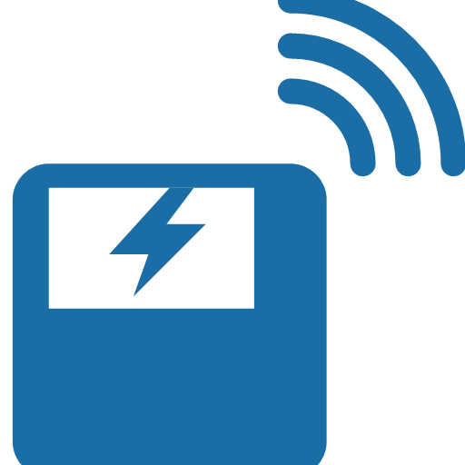

# Home Assistant интеграция WAVIoT Cabinet (lk.waviot.ru)



Custom-интеграция для [Home Assistant](https://www.home-assistant.io/), которая
читает показания электросчётчика из личного кабинета WAVIoT
([lk.waviot.ru](https://lk.waviot.ru)) — там же, где их показывает ваш дом.

Домен интеграции — `waviot_cabinet`, папка `custom_components/waviot_cabinet`.
Домен `waviot` в каталоге уже занят другими интеграциями WAVIoT, поэтому здесь
он свой: обе установки могут сосуществовать в одном Home Assistant.

## Что она делает

- Вход в личный кабинет по логину и паролю (e-mail или телефон) — данные
  вводятся в интерфейсе Home Assistant и нигде не хранятся в коде репозитория.
- Автоматически забирает персональный ключ API со страницы
  `https://lk.waviot.ru/api/`, дальше работает по ключу без cookies.
- Опрашивает кабинет и создавает сущности для каждого счётчика на элементе (доме).

## Сущности

Для каждого счётчика (электричество, вода, газ — что привязано к элементу):

| Сущность | Что это | Единица |
| --- | --- | --- |
| `sensor..._total_energy` | суммарное показание счётчика (`electro_ac_p_lsum_tsum`) | kWh |
| `sensor..._tariff_1..4` | показание по тарифу (только существующие каналы) | kWh |
| `sensor..._total_energy_per_day` | расход за последние 24 часа (из баланса кабинета) | kWh |
| `sensor..._last_reading` | время последней передачи показаний | timestamp |
| `sensor..._battery_voltage` | напряжение батарейки модема (выключено по умолчанию) | V |
| `sensor..._modem_temperature` | температура модема (выключено по умолчанию) | °C |
| `sensor..._signal_strength` | уровень радио-сигнала RSSI (выключено по умолчанию) | dBm |

Суммарные показания имеют `state_class = total_increasing`, поэтому из них
обычными automation'ами/`derive` можно считать дневной расход.

## Установка

### Вручную

1. Скопируйте папку `custom_components/waviot_cabinet` в
   `config/custom_components/waviot_cabinet` вашего Home Assistant.
2. Перезапустите HA.
3. Настройки → Устройства и службы → Интеграции → Добавить интеграцию → **WAVIoT Cabinet**.
4. Введите логин и пароль от личного кабинета.

### Через HACS

Добавьте этот репозиторий как пользовательский (custom) репозиторий в HACS
(тип «Integration») и установите «WAVIoT Cabinet».

## Параметры при добавлении

- **Логин** — e-mail или телефон, которым вы входите в кабинет.
- **Пароль** — пароль от кабинета.
- **Ключ API** — необязательно. Если вставите ключ со страницы
  `https://lk.waviot.ru/api/`, пароль не нужен и интеграция не делает вход.
- **ID элемента** — необязательно. По умолчанию берётся элемент, который
  кабинет показывает на главной странице (`elementId` в `/`). Если у вас
  несколько элементов (дом, дача, квартира), добавьте несколько интеграций с
  разными ID элемента. Список элементов: `https://lk.waviot.ru/api.tree/get_tree/?key=...`.

## Опции

В настройках интеграции можно менять интервал опроса (по умолчанию 15 минут).
Счётчики WAVIoT обычно передают показания раз в час, поэтому чаще опрашивать
смысла нет.

## Двухфакторная авторизация

Если в кабинете включён SMS-код при входе, автоматический вход невозможен:
интеграция сообщит об этом и предложит отключить 2FA или ввести ключ API.

## Если ключ отозвали

Кабинет отвечает `Incorrect API key`, и Home Assistant открывает шаг повторной
авторизации: можно ввести новый пароль (ключ будет получен заново) или новый
ключ API со страницы `https://lk.waviot.ru/api/`.

## Пример: суточный расход в Lovelace

```yaml
sensor.waviot_cabinet_8146244_total_energy          # 46461.016 kWh
sensor.waviot_cabinet_8146244_total_energy_per_day  # 9.566 kWh за сутки
```

## API, который использует интеграция

```
https://lk.waviot.ru/api.data/get_full_element_info/?id=<element>&key=<key>
https://lk.waviot.ru/api.tree/get_modems/?id=<element>&key=<key>
https://lk.waviot.ru/api.data/get_balance_info/?elementId=<element>&from=<ts>&to=<ts>&key=<key>
```

Документация методов: <https://lk.waviot.ru/api/>

## Лицензия

MIT.

